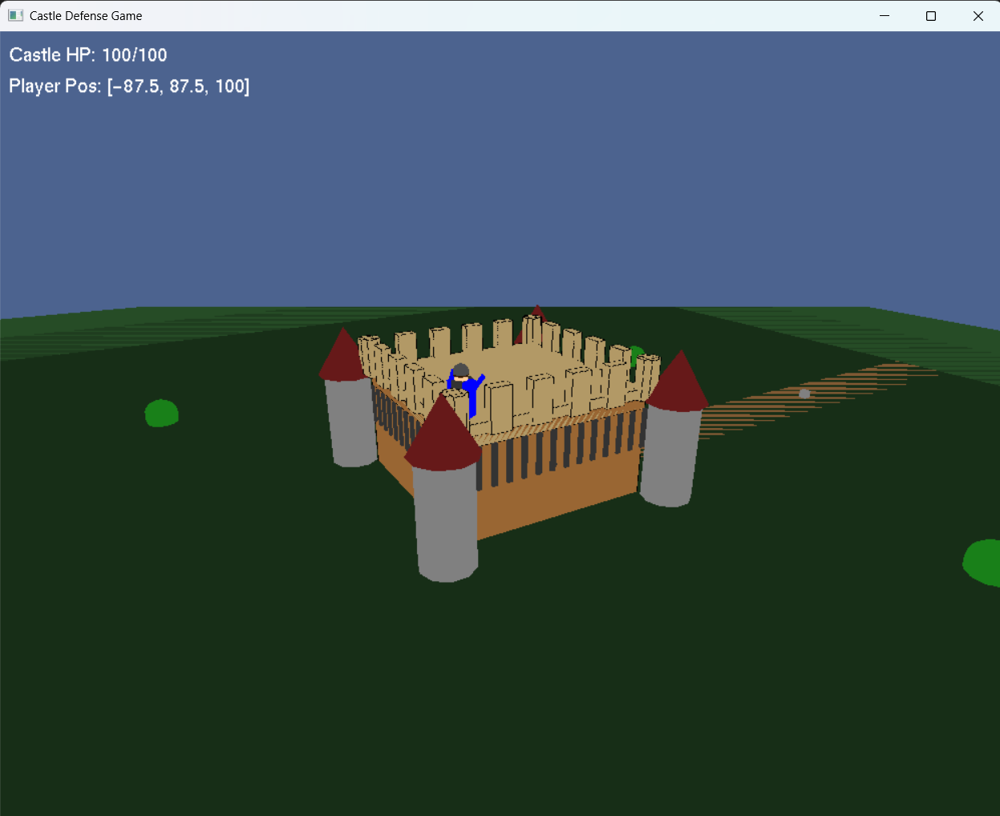

# 3D Castle Defense

Defend your castle from enemies and survive increasingly difficult enemy waves.

  

## Overview

In this game, the player must protect the castle from incoming enemies by attacking them while managing the castle’s health and resources. The game combines combat, strategy and survival mechanics, giving the player the ability to fight enemies, repair the castle and use special defensive tools during critical moments.

## Core Gameplay

- Player movement & shooting
  - Move around the castle and shoot bullets.
  - Controlled by the player.
  - A/D keys rotate left and right.
  - W/S keys move up and down.
  - Left mouse button fires bullets from the gun tip.

- Enemy waves
  - Enemies spawn in groups and move toward the castle.

- Castle walls with HP
  - Enemies damage the wall when they reach it.
  - HP decreases by 10 with each collision.

- Defeat condition
  - The player loses when HP reaches 0.

## Castle & Resources

- Resource system (Gold)
  - Gold is earned for each enemy that is killed.

- Castle repairs
  - Gold can be used to repair the castle walls.
  - Press `g` to buy HP.
  - Each HP costs 5 gold.

## Diplomacy Features (White Flag System)

- White flag raising
  - Press `f` to raise a white flag.
  - The flag can be used a maximum of 5 times.

- Temporary ceasefire
  - Enemies pause and respect the flag for 10 seconds.
  - The player can use this time to clear nearby enemies by shooting them.

- Healing during the flag
  - The castle slowly heals while the flag is active.
  - Enemies regroup after the ceasefire ends.

## Camera Features

- Zoom in / Zoom out
  - Adjust the field of view (FOV) using keys such as `z` to zoom in and `x` to zoom out.
  - This allows the player to snipe or survey the battlefield more effectively.

- Camera movement
  - Use the UP and DOWN arrow keys to move the camera up and down.
  - Use the LEFT and RIGHT arrow keys to rotate the camera left and right.

- Camera mode switching
  - The camera can follow the gun in first-person mode.
  - It can also remain fixed in a default third-person position.
  - Right mouse button toggles between the two modes.

## Visual & Immersion Features

- Day/Night cycle
  - The background color changes gradually over time to simulate a day-night cycle.

## Objective

The main goal is to defend the castle, survive enemy waves, manage resources efficiently and use special abilities strategically to keep the castle standing as long as possible.

## Conclusion

This game combines combat, resource management, diplomacy mechanics, and visual atmosphere to create a dynamic defensive gameplay experience. The player must adapt to increasing pressure, manage healing and upgrades, and make strategic decisions to survive.

